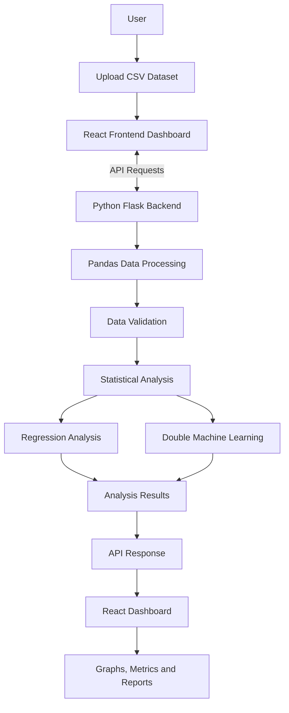
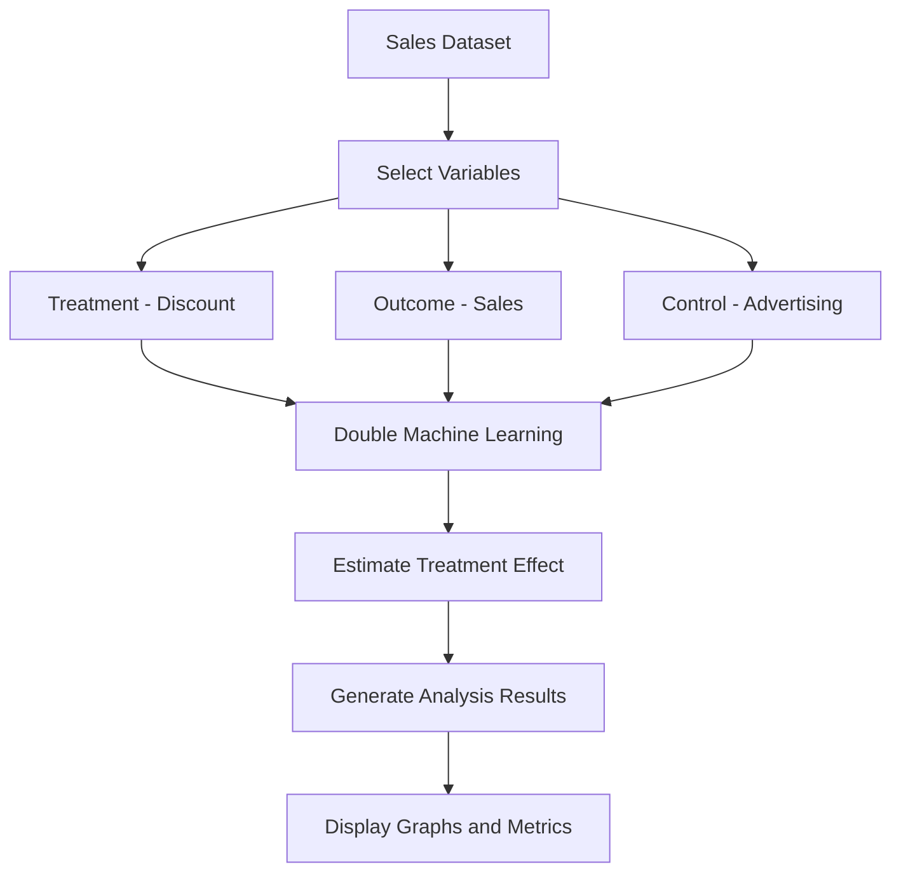

# EconoCausal – Data Analysis and Causal Inference Platform

## 📌 Project Overview

EconoCausal is a web-based data analysis and causal inference application designed to help users understand how different factors influence business outcomes.

Users can upload CSV datasets, explore data, validate data quality, perform regression analysis, and estimate causal effects using Double Machine Learning (DML).

The application provides an interactive dashboard with visualizations, analytical results, metrics, and reports.

## 🎯 Project Objectives

- Make business data analysis easier.
- Upload and explore CSV datasets.
- Identify missing values and data-quality issues.
- Perform regression and statistical analysis.
- Estimate the effect of treatment variables on outcomes.
- Display results using interactive graphs and reports.

## 🏗️ System Architecture

The application follows a frontend and backend architecture.



## 🧠 Double Machine Learning Workflow

Double Machine Learning estimates the effect of a treatment variable on an outcome while considering other control variables.

### Sample Sales Analysis

- **Treatment Variable:** Discount
- **Outcome Variable:** Sales
- **Control Variable:** Advertising



## 💻 Technologies Used

| Technology | Purpose |
|---|---|
| Python | Backend development and data processing |
| Flask | Backend API development |
| React.js | Frontend dashboard |
| JavaScript | Frontend functionality |
| Pandas | Dataset processing |
| NumPy | Numerical operations |
| Scikit-learn | Machine learning and model evaluation |
| Recharts | Data visualization |
| HTML | Application structure |
| CSS | Dashboard styling |
| Git & GitHub | Version control |

## 🚀 Main Features

### 1. Overview Dashboard
Provides an overview of the application and important dataset information.

### 2. Data Explorer
Allows users to upload CSV files and explore datasets.

### 3. Data Management
Helps users work with uploaded datasets.

### 4. Data Validation
Identifies missing values and data-quality issues.

### 5. Causal Analysis
Allows users to select treatment, outcome, and control variables for causal analysis.

### 6. Insights
Displays useful information obtained from data analysis.

### 7. Reports
Presents analytical results in report format.

### 8. AI Intelligence
Provides an additional section for analytical insights.

### 9. Settings
Contains application settings and backend connection information.

## 📊 Sample Dataset

For demonstration, a sample sales dataset is used.

| Discount | Advertising | Sales |
|---:|---:|---:|
| 5 | 10 | 18 |
| 10 | 15 | 25 |
| 15 | 20 | 32 |
| 20 | 25 | 39 |
| 25 | 30 | 46 |
| 30 | 35 | 53 |
| 35 | 40 | 60 |
| 40 | 45 | 67 |

This dataset demonstrates regression and causal analysis using discount, advertising, and sales variables.

## 📈 Model Evaluation

Regression analysis uses evaluation metrics such as:

- **MAE (Mean Absolute Error):** Measures the average difference between actual and predicted values.
- **R-squared:** Measures how well the model explains variation in the outcome.

### Example Results

| Evaluation Metric | Result |
|---|---:|
| MAE | 0.709 |
| R-squared | 0.980 |

### Double Machine Learning Result

| Parameter | Value |
|---|---|
| Treatment | Discount |
| Outcome | Sales |
| Control | Advertising |
| Estimated Treatment Effect | 0.6741 |

*Note: These results are from an earlier sample analysis. Actual results depend on the uploaded dataset.*

## 📁 Project Structure

```text
EconoCausal/
│
├── backend/
│   ├── app.py
│   ├── data_analysis.py
│   ├── day3_model.py
│   ├── day4_dml.py
│   ├── day5_evaluation.py
│   └── streamlit_app.py
│
├── frontend/
│   ├── public/
│   ├── src/
│   │   ├── App.jsx
│   │   ├── main.jsx
│   │   └── styles.css
│   ├── package.json
│   └── index.html
│
├── outputs/
├── sample_data/
├── .gitignore
└── README.md
```

## ⚙️ Installation and Setup

### Prerequisites

- Python
- Node.js and npm
- Git

### 1. Clone the Repository

```bash
git clone https://github.com/keerthana-sakala08/EconoCasual.git
```

### 2. Navigate to the Project Folder

```bash
cd EconoCasual
```

### 3. Install Backend Dependencies

```bash
pip install flask flask-cors pandas numpy scikit-learn matplotlib
```

### 4. Start the Flask Backend

```bash
python backend/app.py
```

Backend URL:

```text
http://127.0.0.1:5000
```

### 5. Install Frontend Dependencies

Open another terminal:

```bash
cd frontend
npm install
```

### 6. Start the React Frontend

```bash
npm run dev
```

Frontend URL:

```text
http://localhost:5173
```

Keep both frontend and backend running while using the application.

## 🔗 API Endpoints

| Endpoint | Purpose |
|---|---|
| `/api/health` | Checks backend health |
| `/api/analyze` | Performs dataset analysis |
| `/api/validate` | Validates uploaded data |
| `/api/validation-report` | Provides validation information |
| `/api/dml` | Performs Double Machine Learning |
| `/api/statistics` | Provides dataset statistics |

## 🔄 Project Workflow

1. Open the EconoCausal dashboard.
2. Upload a CSV dataset.
3. Explore the uploaded data.
4. Validate the dataset.
5. Select treatment, outcome, and control variables.
6. Perform regression or causal analysis.
7. View estimated results and evaluation metrics.
8. Explore graphs, insights, and reports.

## 🔮 Future Improvements

- Improve frontend and backend integration.
- Add support for more dataset formats.
- Include additional machine learning models.
- Improve interactive data visualizations.
- Enhance report generation.
- Add advanced causal inference methods.

## 📝 Conclusion

EconoCausal combines data analysis, machine learning, and web development in a single application.

It provides a platform for exploring datasets, performing regression and causal analysis, and understanding results through interactive visualizations.

The project demonstrates how Python, Flask, React, and machine learning techniques can work together to develop a practical data analysis application.

## 👩‍💻 Developer

**Project Name:** EconoCausal

**Domain:** Data Science and Machine Learning

**GitHub Repository:** [EconoCausal](https://github.com/keerthana-sakala08/EconoCasual)
